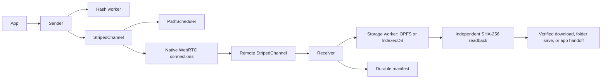

# Code graph

An optional local CodeGraph index can be generated with
[colbymchenry/codegraph](https://github.com/colbymchenry/codegraph), version 1.6.2.
The October 16 index covered 82 files, 1,341 nodes and 3,774 edges.
The generated database lives in `.codegraph/codegraph.db`; it is excluded
from Git and the app and removed by `npm run clean`.
CodeGraph adds no application dependency and no hosted code index.

```sh
DO_NOT_TRACK=1 CODEGRAPH_TELEMETRY=0 npx --yes @colbymchenry/codegraph@1.6.2 init --yes .
DO_NOT_TRACK=1 CODEGRAPH_TELEMETRY=0 npx --yes @colbymchenry/codegraph@1.6.2 sync .
DO_NOT_TRACK=1 CODEGRAPH_TELEMETRY=0 npx --yes @colbymchenry/codegraph@1.6.2 explore 'Sender Receiver StripedChannel PathScheduler' --max-files 3
```

`init` builds the graph. Run `sync` after source edits before using later queries.
The graph provides structural relationships; native WebRTC behavior and asynchronous
browser dispatch still need runtime tests. The October 16 sync reported 18 unresolved references; the graph is a navigation aid rather than a runtime proof. The following transfer map summarizes
those relationships, with the browser boundary shown explicitly:


